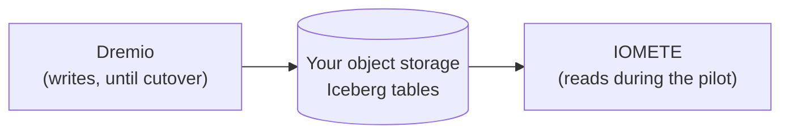

import FAQSection from '@site/src/components/FAQSection';

On July 6, 2026, SAP [finished buying Dremio](https://news.sap.com/2026/07/sap-completes-dremio-acquisition/). If you run Dremio today, nothing broke that day. Your queries still run and your Reflections still refresh.

What changed is who decides where the product goes next. This post covers what that means in practice, what you still control, and what a move to another platform involves if you decide to make one.

{/* truncate */}

A quick note before we start: IOMETE competes with Dremio. We have tried to be fair, and every claim about Dremio or SAP links to their own pages so you can check it.

## What SAP bought, and who it is good news for

SAP [announced the deal in May](https://news.sap.com/2026/05/sap-to-acquire-dremio-unify-sap-and-non-sap-data-power-agentic-ai/), and the plan is clear. Dremio becomes the base of SAP Business Data Cloud, so SAP data and non-SAP data can sit side by side in Apache Iceberg tables without being copied into SAP HANA. Dremio's catalog, built on Apache Polaris, becomes the foundation of the SAP Knowledge Graph. SAP also said it will keep investing in the open-source projects Dremio works on: Iceberg, Polaris, and Arrow.

If your company already runs on SAP and Business Data Cloud is on your roadmap, this is probably good for you. Your lakehouse engine will get closer to the systems your finance and supply chain data already live in, and that is a fair reason to stay.

The rest of this post is for teams where that isn't the case.

## What changes for everyone else

### The roadmap follows SAP's plan now

Before the deal, Dremio decided what to build based on what lakehouse buyers asked for. Now those decisions are made inside a much larger company, and the stated goal for the product is to make Business Data Cloud stronger.

Some of what you care about will line up with that goal. Some of it won't. Think about connectors to non-SAP systems, the self-hosted edition, and pricing that doesn't assume a wider SAP contract. Those items now compete for engineers with integration work SAP has promised in public. You no longer have a direct say in which ones win.

### "We picked an independent vendor" no longer holds

A lot of teams chose Dremio because it was a smaller company built around open formats, and not a large software vendor with a bigger platform to sell. That reason is gone, and it went away without any input from you.

The product didn't get worse overnight. But the risk section of the business case you wrote when you bought Dremio needs a rewrite, and procurement will ask about it at renewal.

### Self-hosted Dremio already talks to the vendor

This one is older than the deal, but it matters more now. Since Dremio 26.0, Dremio Enterprise on Kubernetes [sends telemetry to `observability.dremio.com`](https://docs.dremio.com/current/admin/service-telemetry-kubernetes/). Dremio's documentation says it "must remain enabled" because usage-based billing depends on it. Air-gapped clusters are the exception and report usage through a separate offline process.

Dremio is clear that no query text, results, or business data are sent, and we have no reason to doubt that. Even so, for a bank or hospital running a "self-hosted" platform, a required outbound connection to a vendor is a third-party dependency that has to be documented. The company at the other end of that connection is now SAP.

This matters in the EU because DORA, the EU's operational resilience rules for financial firms, asks banks to check how much they depend on any single provider (Article 29). Many banks already run SAP for finance, HR, and supply chain. With Dremio inside SAP, the analytics platform now depends on that same provider, so more of the bank's critical systems rely on one company. SAP is also one of the providers EU regulators have [designated as critical](https://www.esma.europa.eu/sites/default/files/2025-11/List_of_designated_CTPPs.pdf) because so many financial firms already depend on it. That's worth recording in your concentration risk assessment.

## What is still yours: the tables, if you planned for it

If your Dremio tables are Apache Iceberg tables in your own object storage, you already own the most important part of your lakehouse. The Parquet data files and Iceberg metadata live in your S3, ADLS, GCS, or on-premises object store, and any engine that reads Iceberg can open them.

Tables are only part of it, though. To leave a platform cleanly, you also need to take these with you:

- **The catalog:** which tables exist and where their current metadata file is.
- **Permissions:** who can see which tables, rows, and columns.
- **Audit history:** who queried what, and when.
- **Lineage:** which tables and views feed which.

Open table formats solve the first problem. The rest depend on where your catalog, policies, and logs live, and on whether you can export them without the vendor's help. It is worth checking each one now, while nothing is urgent.

## If you are in a regulated EU industry

We have written about DORA in detail before, in [DORA and the EU AI Act for financial institutions](/resources/blog/dora-eu-ai-act-financial-institutions-data-infrastructure) and [data sovereignty for regulated finance](/resources/blog/data-sovereignty-regulated-finance-dora-private-cloud). For Dremio customers specifically, four steps are worth doing this quarter, whatever you decide about the platform:

1. **Update your register of information** (DORA Article 28) to record that Dremio is now controlled by SAP.
2. **Ask for a written commitment** on the future of the self-hosted edition: the support timeline, and whether it will keep the same features as the managed cloud version.
3. **Revisit the exit clause** (DORA Article 30) while your contract is being moved over to SAP. That is when you can negotiate what an exit includes, such as catalog export, permissions, and audit history.
4. **Rehearse an exit.** Pick a few real tables and move them to a second catalog and engine. A tested exit plan carries more weight with a regulator than a written one.

## How a move off Dremio works, step by step

If you decide to look at alternatives, here is the work involved. It applies to any platform that runs on Iceberg, not only ours.

The safest approach is to run both platforms side by side on the same data, then move workloads over one at a time. Nobody has to switch everything over in a single weekend.



### Step 1: Register your tables in the new catalog

Iceberg tables can be added to a new catalog without copying any data. Iceberg's `register_table` procedure points the new catalog at a table's existing metadata file:

```sql
CALL spark_catalog.system.register_table(
  table         => 'sales.orders',
  metadata_file => 's3://lakehouse/sales/orders/metadata/00042-<uuid>.metadata.json'
);
```

Two things to know before you do this:

- **It is a point-in-time copy of the table's state.** The new catalog sees the table as it was in that metadata file. New writes from Dremio won't show up until you register the newer metadata file. That is fine for a pilot. At cutover, register the latest file and switch your pipelines over.
- **Only one platform should write to a table, and only one should clean it up.** If both catalogs write to the same table, each loses track of the other's commits. If both run snapshot expiry or orphan file cleanup, one can delete files the other still needs. Until cutover, keep Dremio as the only writer and turn off maintenance for those tables on the new platform.

The full procedure is in our [Iceberg procedures reference](/resources/reference/iceberg-tables/iceberg-procedures).

### Step 2: Translate your views

Dremio views (Dremio calls them virtual datasets) are written in Dremio's SQL dialect. Standard SQL carries over to Spark SQL as is. Dremio-specific functions and syntax need a review. Start by listing all your spaces and views, since that tells you how big this step is.

### Step 3: Replace Reflections

Reflections are Dremio's own caching layer, and they don't move to any other platform. You'll reach the same speed differently, with materialized tables, good partitioning and sort order, regular compaction, and properly sized compute.

On IOMETE, the [Apache DataFusion Comet acceleration in IOMETE 4.0](/resources/blog/apache-datafusion-comet-spark-acceleration) cut total TPC-DS run time by 42% without changing any SQL. Still, test the dashboards your business actually depends on rather than relying on a benchmark, ours included.

### Step 4: Check every federated source

If you query operational databases directly through Dremio, list each connection. IOMETE supports [query federation](/resources/reference/sql-quick-start/query-federation) with JDBC databases such as MySQL, PostgreSQL, SQL Server, and Oracle, as well as Snowflake and files in object storage. For each source, decide whether to keep querying it in place or load it into Iceberg.

### Step 5: Rebuild access policies

Row filters, column masks, and role mappings have to be recreated in the new platform's policy model and tested against your identity provider. Test this step with real users before cutover, because a mistake here exposes data.

## Where IOMETE fits

IOMETE is a data lakehouse built on Apache Spark and Apache Iceberg that runs on Kubernetes. It deploys entirely inside your own infrastructure: on-premises, private cloud, sovereign cloud, or your own public cloud account. No part of it that touches your data runs outside your network, and it runs in fully air-gapped environments. Our post on the [control plane and data plane](/resources/blog/control-plane-vs-data-plane) explains how that is split.

For Dremio customers, these are the parts that matter most:

- **Iceberg-native, with an Iceberg REST catalog.** Your existing tables can be registered in place, and other Iceberg engines such as Trino, Flink, DuckDB, and PyIceberg can keep reading the same files.
- **Access control inside your network.** Row-level security, column masking, and tag-based policies are applied at query time and connected to your identity provider. Audit logs stay in your infrastructure.
- **One engine for SQL, pipelines, streaming, and machine learning.** Spark handles BI queries, batch jobs, and notebooks on the same tables.
- **Your hardware, your costs.** Compute runs on your Kubernetes clusters, under your quotas, reserved capacity, and cloud discounts.

There are trade-offs too. IOMETE assumes your team is comfortable running Kubernetes. Spark is a different engine from Dremio's, so dashboards where speed is critical deserve a side-by-side test before you commit.

## Which path fits you

- **Stay on Dremio** if your company is committed to SAP and Business Data Cloud. Ask SAP for written answers on the self-hosted edition, the licensing model, and the connectors you depend on.
- **Run an evaluation** if you chose Dremio for independence or data sovereignty. Register a handful of real tables in a second catalog, translate your most important views, and compare results on your own workloads before your renewal date.

Either way, keep your tables in Iceberg on storage you own, and make sure your catalog, permissions, and audit history can be exported. Then the next acquisition, including one of us, doesn't become your problem.

If you want help with an evaluation, [talk to our team](https://iomete.com/contact-us). We can run a pilot against your existing Iceberg tables, in your environment, without moving any data.

## FAQ

<FAQSection faqs={[
  {
    question: "Did SAP acquire Dremio?",
    answer: "Yes. SAP announced the deal on May 4, 2026 and completed it on July 6, 2026. Dremio is becoming the Apache Iceberg-based foundation of SAP Business Data Cloud."
  },
  {
    question: "Can I migrate from Dremio without copying my data?",
    answer: "If your Dremio tables are Apache Iceberg tables in your own object storage, yes. Iceberg's register_table procedure adds an existing table to a new catalog by pointing it at the table's metadata file, so the data files stay where they are. Views, Reflections, federated sources, and access policies still need to be moved separately."
  },
  {
    question: "Can Dremio and IOMETE use the same Iceberg tables at the same time?",
    answer: "Yes for reading, with care. Keep a single platform writing to each table and running maintenance on it until cutover. A registered table reflects the metadata file you registered, so refresh it by registering the newer metadata file when you need newer data."
  },
  {
    question: "Do Dremio Reflections migrate to another platform?",
    answer: "No. Reflections are specific to Dremio. On another platform you reach similar performance with materialized tables, partitioning and sort order, compaction, and properly sized compute."
  },
  {
    question: "Does the acquisition affect DORA compliance for Dremio customers?",
    answer: "It changes your third-party picture. Record the change of control in your DORA register of information, and update your concentration risk assessment (Article 29), especially if you already rely on SAP for other critical systems. This is also a good time to revisit exit terms while contracts move to SAP."
  },
  {
    question: "Is there a self-hosted Dremio alternative for air-gapped environments?",
    answer: "IOMETE is a self-hosted lakehouse built on Apache Spark and Apache Iceberg that runs on Kubernetes inside your own infrastructure, including fully air-gapped environments."
  }
]} />
