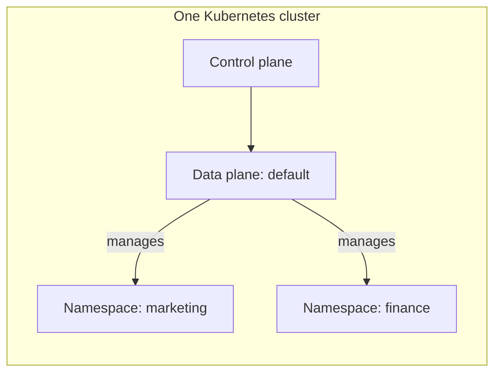

Add a namespace when you want a separate place to run a team's computes, Spark jobs, or notebooks. You can then give that namespace its own [CPU and memory quotas](/resources/user-guide/namespace-quotas).

This walkthrough adds a namespace to the **default data plane** installed with the IOMETE control plane. At the end, you will assign the namespace to a domain and run a compute in it.

## Understanding Data Planes and Namespaces

The **control plane** provides the IOMETE console and manages platform configuration. A **data plane** is the set of IOMETE services that manages and runs your workloads. A **Kubernetes namespace** groups resources inside a Kubernetes cluster. A data plane can manage workloads in several namespaces.

There is no one-to-one relationship:

- One Kubernetes cluster can host several IOMETE data planes.
- One data plane can manage several namespaces in that cluster.
- Adding a namespace to a data plane does not create another data plane.

For example, this is a valid arrangement within **one Kubernetes cluster**:



This guide adds `finance` to the existing `default` data plane. Both namespaces share the Kubernetes cluster's capacity. A domain gives users access to the namespaces assigned to it.

A cluster can also host additional data planes, each managing its own namespaces. See [Multi-Cluster Setup](./multi-cluster-setup.mdx) for that topology.

## Before You Start

You need access to the Kubernetes cluster that hosts the data plane, its existing Helm values file, and permission to manage domain namespaces in the IOMETE admin console.

The examples use these names. Replace them with your installation's names where needed:

| Name | Meaning |
| --- | --- |
| `data-plane` | Existing Helm release |
| `iomete-system` | Namespace containing the control plane and default data plane services |
| `marketing` | An existing workload namespace to keep |
| `finance` | New workload namespace to add |

Check the release and installed chart version:

```shell
helm list --namespace iomete-system
```

Use the version from the **CHART** column for the upgrade below: for example, `iomete-data-plane-enterprise-4.0.1` means version `4.0.1`. Keep your complete values file; the YAML examples on this page show only the settings to change.

:::info Separately installed data planes
If you are adding a namespace to another data plane, such as `research`, update that data plane's own `iomete-lakehouse-runtime` release and values file. See [Adding a Namespace to Another Data Plane](#adding-a-namespace-to-another-data-plane) for the differences.
:::

## 1. Creating the Namespace

Run these commands in the Kubernetes cluster that hosts the data plane:

```shell
kubectl create namespace finance
kubectl label namespace finance iomete.com/managed=true
```

If the namespace already exists, first check that another IOMETE data plane does not already manage it in this Kubernetes cluster. Use separate workload namespaces for separate data planes so their releases do not compete to manage the same resources. For an existing namespace you intend to use here, run only the label command, adding `--overwrite` if needed.

## 2. Updating Your Values File

Add `finance` to the `namespaces` list in your existing `values.yaml`. **Keep every namespace already in the list.** For example:

```yaml title="values.yaml"
namespaces:
  - marketing # Existing namespace: keep this entry.
  - finance   # New namespace.
```

The namespace containing the data plane's services is managed automatically, so you do not need to add `iomete-system` to this list.

## 3. Preparing Access and Secrets

### Service Account and Permissions

The namespace needs `lakehouse-service-account`, a Role, and a RoleBinding so IOMETE can manage workloads there.

- If `serviceAccount.create: true`, Helm creates these during the upgrade. No manual step is needed.
- If `serviceAccount.create: false`, ask your Kubernetes administrator to regenerate and apply them using [Option 2 in the installation guide](./on-prem/install.md#option-2-have-an-administrator-create-them). Use the updated values file so the generated resources include `finance`.
- For chart versions 3.19.0 or earlier, complete the [manual setup below](#installing-3190-or-earlier).

### Spark Operator Webhook

The webhook prepares Spark pods when Kubernetes creates them.

- If Helm manages the webhook and `webhook.create: true`, Helm updates it during the upgrade.
- If you created it with `gencerts.sh`, the `iomete.com/managed=true` label is enough.
- If an administrator created it using the installation guide, update its namespace list before upgrading.

<details>
<summary>Updating an administrator-managed webhook</summary>

For the last case, include the service namespace and **all** workload namespaces. An existing administrator-managed webhook still needs this update even if you later set `webhook.create: true`. This example keeps `marketing` and adds `finance`; replace the webhook name if you configured a different `webhook.name`:

```shell
kubectl patch mutatingwebhookconfiguration spark-operator-iomete-system \
  --type=strategic \
  -p='{"webhooks":[{"name":"webhook.sparkoperator.k8s.io","namespaceSelector":{"matchExpressions":[{"key":"kubernetes.io/metadata.name","operator":"In","values":["iomete-system","marketing","finance"]}]}}]}'
```

</details>

### Optional Secrets

If you use a private image registry or a custom Java truststore, create the required Secrets before upgrading. Otherwise, continue to step 4.

<details>
<summary>Preparing registry and truststore Secrets</summary>

Kubernetes reads a pod's Secrets from the pod's own namespace. Helm does not copy your existing Secrets into `finance`.

| If your installation uses… | Create in `finance` before upgrading |
| --- | --- |
| A private image registry | Each Secret listed under `docker.imagePullSecrets`. See [Private Docker Registry Authentication](/resources/user-guide/k8s/private-docker-registry). |
| A custom Java truststore | The Secret named by `javaTrustStore.secretName` when `javaTrustStore.enabled: true`. The default name is `java-truststore`. See [Creating the Truststore Secret](./truststore.md#3-create-a-kubernetes-secret-with-the-truststorejks-file). |

If neither applies, skip this step. For an older or customized installation, also check whether its workload templates reference any other Secrets.

For Helm-created service accounts, list the registry Secret names under `docker.imagePullSecrets` in your values file; Helm attaches them when it creates the account during the upgrade. Do this even if you previously configured registry access by patching an account manually. If you manage the service account yourself, add its image pull Secrets after creating the account in step 3 and before upgrading.

</details>

## 4. Upgrading the Existing Release

Use the same chart version that is already installed:

```shell
export IOMETE_VERSION="<installed-chart-version>"

helm upgrade data-plane iomete/iomete-data-plane-enterprise \
  --namespace iomete-system \
  --version "$IOMETE_VERSION" \
  --values values.yaml \
  --wait
```

## 5. Waiting for IOMETE {#restart-iom-cluster}

IOMETE must load the updated namespace list before you can assign `finance` to a domain. Wait for the namespace management service to be ready:

```shell
kubectl rollout status deployment/iom-cluster -n iomete-system
```

Charts with automatic namespace restarts reload the list during the upgrade. Older charts may leave the service running with the previous list. If `finance` is missing or its assignment is rejected in the next step, follow [Refreshing the Namespace List](#refreshing-the-namespace-list).

On IOMETE 3.15 or earlier, use `deployment/iom-core` instead of `deployment/iom-cluster`.

## 6. Assigning the Namespace to a Domain

1. In the admin console, open **Domains** and select the domain that should use the namespace.
2. Open **Namespaces** and select **Add Namespace**.
3. Choose `finance`. If the picker groups namespaces by data plane, choose it under **default**.
4. Confirm the assignment with **Add**, if shown.

Check that `finance` appears in the domain's namespace list under the expected data plane.

## 7. Verifying a Workload

In that domain, create and start a small compute with `finance` selected as its namespace. Run a query such as `SELECT 1` in the SQL editor, then check its pods:

```shell
kubectl get pods -n finance
```

The compute's driver should be `Running`. A compute configured with executors should also have executor pods there. A successful query confirms that the namespace is usable, beyond just appearing in the console.

## Troubleshooting

### Refreshing the Namespace List

If the namespace is missing, or assignment reports `Namespace finance is not allowed` or `Namespace finance is not known to iom-cluster for data plane default`, first check that you updated the correct Helm release and kept `finance` in its `namespaces` list.

For the default data plane, refresh the list with:

```shell
kubectl rollout restart deployment/iom-cluster -n iomete-system
kubectl rollout status deployment/iom-cluster -n iomete-system
```

Then retry the assignment. On IOMETE 3.15 or earlier, replace `iom-cluster` with `iom-core` in both commands. These namespace validation messages do not by themselves mean that the user needs more permissions.

### Rolling Back a Namespace Change

For the default data plane, `helm rollback` alone does not restore the namespace settings stored by IOMETE. Put the intended complete namespace list in your values file, apply it with `helm upgrade`, and restart `iom-cluster` with the commands above, even if your chart normally restarts it automatically. On IOMETE 3.15 or earlier, restart `iom-core` instead.

## Adding a Namespace to Another Data Plane

<details>
<summary>Steps for a separately installed runtime</summary>

For a separately installed data plane in IOMETE 4.0 or later, the Kubernetes namespace and preparation steps are similar, but the configuration belongs to that data plane's own release:

1. Create and label the namespace in the Kubernetes cluster hosting that data plane.
2. Add it to that release's `namespaces` list, keeping the existing entries. Prepare its service account, webhook access, and required Secrets. Spark workloads may need the truststore configured on the control plane, even if the data plane's runtime services do not use one.
3. Upgrade the existing `iomete-lakehouse-runtime` release using its complete values file and installed chart version:

   ```shell
   helm upgrade <data-plane-release> iomete/iomete-lakehouse-runtime \
     --namespace <data-plane-service-namespace> \
     --version <installed-chart-version> \
     --values <data-plane-values-file> \
     --wait
   ```

4. Wait for that data plane's agent to finish its rollout:

   ```shell
   kubectl rollout status deployment/iomete-lakehouse-agent \
     --namespace <data-plane-service-namespace>
   ```

5. In **Data Planes**, check that the plane is connected and reports the namespace. Assign the namespace to a domain under that plane, then verify a compute as above.

The agent reports these namespaces to the control plane. You do not need to restart the control plane's `iom-cluster` to refresh an additional data plane's namespace list.

</details>

## Installing 3.19.0 or Earlier {#installing-3190-or-earlier}

<details>
<summary>Manual service account setup for chart versions 3.19.0 and earlier</summary>

Create the service account and permissions before the Helm upgrade:

```shell
wget https://raw.githubusercontent.com/iomete/iomete-deployment/main/service-account.yaml
kubectl apply -n finance -f service-account.yaml

wget https://raw.githubusercontent.com/iomete/iomete-deployment/main/role-binding-to-control-plane.yaml
export CP_NAMESPACE=iomete-system

sed -i "s/{{control-plane-namespace}}/$CP_NAMESPACE/g" role-binding-to-control-plane.yaml
# On macOS, use this form instead:
# sed -i '' "s/{{control-plane-namespace}}/$CP_NAMESPACE/g" role-binding-to-control-plane.yaml

kubectl apply -n finance -f role-binding-to-control-plane.yaml
```

</details>
