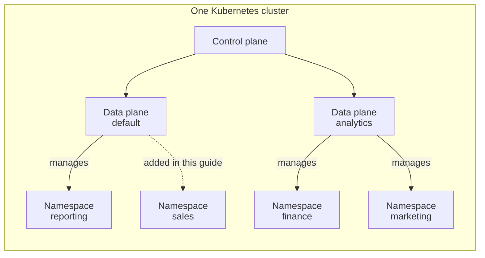

Add a namespace when you want a separate place to run a team's computes, Spark jobs, or Jupyter containers. You can then give that namespace its own [CPU and memory quotas](/resources/user-guide/namespace-quotas).

This walkthrough adds the namespace `sales` to the **default data plane**, which the control-plane release installs. At the end, you assign `sales` to the `business` domain and run a compute in it.

## Understanding Data Planes and Namespaces

- The **control plane** provides the IOMETE console and APIs, and keeps the platform's configuration. Its Helm release, the **control-plane release** (chart `iomete-data-plane-enterprise`), also installs the **default data plane**, named `default`.
- A **data plane** runs and manages your workloads. Besides `default`, you can install **additional data planes**. Each one has its own runtime release (chart `iomete-lakehouse-runtime`).
- Each release installs its services into one Kubernetes namespace, its **service namespace**. Workloads run in **workload namespaces**: the namespaces listed in the release's `namespaces` value, plus the service namespace itself.
- An IOMETE **domain** groups users and their resources. A **namespace assignment** lets a domain use a workload namespace on a specific data plane.

These don't map one to one:

- One Kubernetes cluster can host several data planes.
- One data plane can manage several workload namespaces in that cluster.
- Adding a namespace to a data plane doesn't create another data plane.

For example, this is a valid arrangement within one Kubernetes cluster:



This guide adds `sales` to `default`, next to the existing `reporting`. Both namespaces share the cluster's capacity.

`analytics` is an additional data plane with its own runtime release and workload namespaces. Each workload namespace belongs to one data plane only. To add a namespace to an additional data plane, see [Adding a Namespace to an Additional Data Plane](#adding-a-namespace-to-an-additional-data-plane). To install one, see [Multi-Cluster Setup](./multi-cluster-setup.mdx).

## Before You Start

You need:

- `kubectl` and `helm` access to the Kubernetes cluster that hosts the default data plane, with permission to create namespaces and upgrade the control-plane release.
- The control-plane release's complete values file. If you don't have it, you can export it, as shown below.
- The `iomete` Helm repository on the machine where you run `helm`. See [Add IOMETE Helm Repository](./on-prem/install.md#add-iomete-helm-repository).
- Access to the **Admin Portal** with the **Domain Manager** admin role, to assign the namespace to a domain. See [Admin Roles](/resources/user-guide/admin-roles).

The examples use these names. Replace them with your installation's names:

| Name | Meaning |
| --- | --- |
| `data-plane` | The control-plane release |
| `iomete-system` | Its service namespace, where the control-plane services and the default data plane's services run |
| `reporting` | Existing workload namespace to keep |
| `sales` | New workload namespace to add |
| `business` | Domain that will use `sales` |

Check the release and its installed chart version:

```shell
helm list --namespace iomete-system
```

```text
NAME        NAMESPACE      REVISION  UPDATED                                  STATUS    CHART                               APP VERSION
data-plane  iomete-system  12        2026-10-08 09:14:02.511278 +0000 UTC     deployed  iomete-data-plane-enterprise-4.0.1  4.0.1
```

Note the version at the end of the **CHART** column, here `4.0.1`. Step 4 upgrades to the same version, so the upgrade changes only the namespace list.

The upgrade needs your complete values file. The YAML on this page shows only the settings to change. If you don't have the file, save the values the release was installed or last upgraded with:

```shell
helm get values data-plane --namespace iomete-system --output yaml > values.yaml
```

This file holds only the values that were set, not the chart's defaults, which is what an upgrade needs. It can contain credentials, such as `database.password`, so keep it private.

:::info Additional data planes
To add a namespace to an additional data plane, such as `analytics`, change that data plane's runtime release instead. See [Adding a Namespace to an Additional Data Plane](#adding-a-namespace-to-an-additional-data-plane).
:::

## 1. Creating the Namespace {#create-new-namespace-for-data-plane-instance}

In the Kubernetes cluster that hosts the default data plane, create the namespace and label it for IOMETE:

```shell
kubectl create namespace sales
kubectl label namespace sales iomete.com/managed=true
```

You should see:

```text
namespace/sales created
namespace/sales labeled
```

If the namespace already exists, check that no other IOMETE data plane manages it. Two releases can't share a workload namespace: Helm refuses to take over resources that another release created. To use an existing namespace, run only the `label` command, adding `--overwrite` if the label is already set.

## 2. Updating Your Values File {#add-the-namespace-to-your-values-file}

Add `sales` to the `namespaces` list in your values file. **Keep every namespace already in the list.** A namespace you leave out is removed from the data plane. For example:

```yaml title="values.yaml"
namespaces:
  - reporting # Existing namespace: keep this entry.
  - sales     # New namespace.
```

Don't add `iomete-system`. The release always manages its own service namespace.

## 3. Preparing Access and Secrets

Check these three things before you upgrade.

### Service Account and Permissions {#create-the-service-account-and-role}

IOMETE runs its pods in `sales` as `lakehouse-service-account`, which needs the `iomete-lakehouse-role` Role and a RoleBinding there.

- With `serviceAccount.create: true` in your values file, Helm creates them during the upgrade. Nothing to do.
- With `serviceAccount.create: false`, ask your Kubernetes administrator to regenerate and apply them from your updated values file, as in step 1 of [Option 2 in the installation guide](./on-prem/install.md#option-2-have-an-administrator-create-them). Then check that they exist:

  ```shell
  kubectl get serviceaccount,role,rolebinding --namespace sales
  ```

  The output lists `lakehouse-service-account`, `iomete-lakehouse-role` and `iomete-lakehouse-role-binding`.

- With chart version 3.19.0 or earlier, create them as described in [Creating the Service Account and Role on 3.19.0 or Earlier](#installing-3190-or-earlier).

### Spark Operator Webhook {#add-the-namespace-to-the-webhook}

The Spark Operator webhook prepares Spark pods as Kubernetes creates them, so it must cover `sales`. Check who manages the webhook and how it selects namespaces:

```shell
kubectl get mutatingwebhookconfiguration spark-operator-iomete-system \
  -o jsonpath='{.metadata.annotations.meta\.helm\.sh/release-name}{"\n"}{.webhooks[0].namespaceSelector}{"\n"}'
```

If you set `webhook.name`, use that name instead of `spark-operator-iomete-system`. The output has two lines: the Helm release that owns the webhook, if any, and its namespace selector.

| Output | Meaning | What to do |
| --- | --- | --- |
| First line is `data-plane` | Helm manages the webhook (`webhook.create: true`). | Nothing. The upgrade adds `sales`. |
| Selector uses `iomete.com/managed` | The webhook selects namespaces by label, as older installations set it up. | Nothing. The label from step 1 is enough. |
| First line is empty, and the selector lists namespace names | An administrator created the webhook. Helm doesn't change it, even with `webhook.create: true`. | Add `sales` before upgrading, with the command below. |

To update an administrator-managed webhook, list the service namespace and **all** workload namespaces. This example keeps `reporting` and adds `sales`:

```shell
kubectl patch mutatingwebhookconfiguration spark-operator-iomete-system \
  --type=strategic \
  -p='{"webhooks":[{"name":"webhook.sparkoperator.k8s.io","namespaceSelector":{"matchExpressions":[{"key":"kubernetes.io/metadata.name","operator":"In","values":["iomete-system","reporting","sales"]}]}}]}'
```

### Secrets in the New Namespace

A pod can use only the Secrets in its own namespace, and the chart doesn't copy your Secrets into `sales`. Check your values file for the settings below. For each one that is set, create its Secret in `sales` before upgrading:

| Setting in your values file | Secret to create in `sales` | Pods that use it | If it's missing |
| --- | --- | --- | --- |
| `database.passwordSecret.name` | The Secret it names | `spark-proxy-server-sales`, which runs while `features.sparkProxyForArrowFlight.enabled` is `true` (the default) | The pod fails with `CreateContainerConfigError`, and the upgrade times out. |
| `docker.imagePullSecrets` | Each Secret listed | Every pod in `sales`, through `lakehouse-service-account` | Pods fail with `ImagePullBackOff`. |
| `javaTrustStore.enabled: true` | The Secret named by `javaTrustStore.secretName` (default `java-truststore`). See [Custom Java Truststore](./truststore.md#3-create-a-kubernetes-secret-with-the-truststorejks-file). | `spark-proxy-server-sales`, compute, Spark job and event stream pods, and `prefect-worker-sales` when `javaTrustStore.caCertFileName` is set | Pods stay in `ContainerCreating`. |

If none of these settings is set, `sales` needs no Secrets. Continue to step 4.

Each of these Secrets already exists in `iomete-system`, where the IOMETE services use it. To copy them, put your Secret names in the list and run this command. It needs [`jq`](https://github.com/jqlang/jq):

```shell
for secret in byo-db-creds iomete-image-pull-secret java-truststore; do
  kubectl get secret "$secret" --namespace iomete-system --output json \
    | jq '{apiVersion, kind, type, metadata: {name: .metadata.name}, data}' \
    | kubectl apply --namespace sales --filename -
done
```

You should see a line such as `secret/byo-db-creds created` for each Secret.

List registry Secrets in `docker.imagePullSecrets` even if you added them to existing service accounts by hand. A service account that Helm creates in `sales` gets only the Secrets listed there.

## 4. Upgrading the Existing Release {#upgrade-iomete}

Upgrade the release with your values file and the chart version you noted in [Before You Start](#before-you-start):

```shell
export IOMETE_VERSION="<installed-chart-version>"   # For example, 4.0.1

helm upgrade data-plane iomete/iomete-data-plane-enterprise \
  --namespace iomete-system \
  --version "$IOMETE_VERSION" \
  --values values.yaml \
  --wait
```

With `--wait`, Helm returns when the release's pods are ready, including the new pods in `sales`. Check them:

```shell
kubectl get pods --namespace sales
```

```text
NAME                                       READY   STATUS    RESTARTS   AGE
prefect-worker-sales-6c9f7d8b5-k2x8p       2/2     Running   0          2m
spark-proxy-server-sales-5d8b9c7f6-r4t7w   1/1     Running   0          2m
```

`prefect-worker-sales` runs the Job Orchestrator's Spark jobs in `sales`. `spark-proxy-server-sales` handles Arrow Flight connections and runs only while `features.sparkProxyForArrowFlight.enabled` is `true`.

If a pod isn't `Running`, run `kubectl describe pod --namespace sales <pod-name>`. Its **Events** name the missing Secret or image.

| Status | Usual cause | Fix |
| --- | --- | --- |
| `CreateContainerConfigError` | A Secret that the pod reads a setting from is missing, usually the one named by `database.passwordSecret.name`. | Create the Secret in `sales`, as in step 3. |
| `ContainerCreating` for several minutes, with `FailedMount` events | A Secret mounted as a volume is missing, usually the truststore Secret. | Create the Secret in `sales`, as in step 3. |
| `ErrImagePull` or `ImagePullBackOff` | A registry Secret is missing in `sales`, or `docker.imagePullSecrets` doesn't list it. | Create the Secret, add it to `docker.imagePullSecrets` if needed, and run the upgrade again. Then delete the pod so it restarts with the Secret. |

Kubernetes keeps retrying, so a pod starts by itself once its Secret exists. If `helm upgrade` timed out in the meantime, run it again when the pods are running, so Helm records a successful upgrade.

## 5. Restarting `iom-cluster` {#restart-iom-cluster}

`iom-cluster` checks every namespace assignment on the default data plane against the namespace list it read when it started. In IOMETE 4.0.0 and 4.0.1, `helm upgrade` doesn't restart it when only `namespaces` changes. Restart it now:

```shell
kubectl rollout restart deployment/iom-cluster --namespace iomete-system
kubectl rollout status deployment/iom-cluster --namespace iomete-system
```

The second command waits for the new pod to be ready, then prints:

```text
deployment "iom-cluster" successfully rolled out
```

The restart is a rolling update. It's safe to run even if `iom-cluster` already restarted during the upgrade. If you skip it, step 6 fails with **Access denied** and the message `Namespace sales is not allowed`.

On IOMETE 3.15 or earlier, restart `deployment/iom-core` instead.

## 6. Assigning the Namespace to a Domain

1. In the **Admin Portal**, open **Domains** and select `business`.
2. On the **Namespaces** tab, select **Add Namespace**.
3. Under **default**, select `sales`, then select **Add**.

You should see **Namespace added**, and `sales` appears in the list with `default` in the **Data plane** column. If `sales` isn't offered or **Add** fails, see [Troubleshooting](#troubleshooting).

IOMETE also adds `sales` to a resource bundle named `namespace-business-sales-default`. Users who aren't domain owners need the **Use** permission on `sales`, through a resource bundle, before they can deploy to it. See [RAS Permissions](/resources/user-guide/ras/permissions#namespace).

## 7. Verifying a Workload

1. In the `business` domain, create a small compute, here `sales-check`. In **Deploy to Kubernetes namespace**, choose `sales` under **default**. If `sales` isn't listed, select **Refresh namespaces** in the list.
2. Start the compute, then run `SELECT 1` on it in the **SQL Editor**.
3. Check its pods:

   ```shell
   kubectl get pods --namespace sales
   ```

   ```text
   NAME                                       READY   STATUS    RESTARTS   AGE
   cc-sales-check-driver                      1/1     Running   0          4m
   cc-sales-check-3f9a6c1e8b2d7a40-exec-1     1/1     Running   0          3m
   prefect-worker-sales-6c9f7d8b5-k2x8p       2/2     Running   0          20m
   spark-proxy-server-sales-5d8b9c7f6-r4t7w   1/1     Running   0          20m
   ```

A compute's pods start with `cc-` and its name. A compute without executors has only the driver pod. When the query returns its result, `sales` is ready for the team's workloads.

## Troubleshooting

### The Namespace Isn't Offered in Add Namespace

**Add Namespace** offers the namespaces that each connected data plane's agent reports. The upgrade restarts the default data plane's agent, `iomete-lakehouse-agent` in `iomete-system`, with the new list. The agent reports it every few seconds. If `sales` isn't offered:

1. Check that the release has the new list. In the output of `helm get values data-plane --namespace iomete-system`, `namespaces` must include `sales`. If it doesn't, repeat steps 2 and 4 with the right values file.
2. Check that the agent restarted:

   ```shell
   kubectl rollout status deployment/iomete-lakehouse-agent --namespace iomete-system
   ```

3. In the **Admin Portal**, open **Data Planes** and select `default`. Its status must be **Connected**, and `sales` must appear under **Namespace quotas**. Namespaces of a disconnected data plane aren't offered.
4. Reload the domain page and open **Add Namespace** again.

### Adding the Namespace Fails with Access Denied

If **Add** shows an **Access denied** message with the text `Namespace sales is not allowed`, `iom-cluster` is still using its old namespace list. The API returns HTTP 403 with the error code `ACCESS_DENIED`. Despite the title, your permissions are not the problem.

1. Restart `iom-cluster` as in [step 5](#restart-iom-cluster), then add the namespace again.
2. If it still fails, check that `helm get values data-plane --namespace iomete-system` lists `sales` under `namespaces`. If it doesn't, the upgrade used a values file without `sales`. Repeat steps 2, 4 and 5.

### Rolling Back a Namespace Change

To remove `sales` again, upgrade forward with the namespace removed. Don't use `helm rollback` for this. IOMETE services read their settings from the `iomete-helm-values` Secret in `iomete-system`. The chart writes that Secret in a pre-install and pre-upgrade hook, and `helm rollback` doesn't run those hooks. After a rollback, that Secret would still list `sales`.

1. Stop the workloads that run in `sales`: computes, Spark jobs, streaming jobs, Jupyter containers and event streams. Move or delete Spark jobs that deploy there. Then `kubectl get pods --namespace sales` should list only the `prefect-worker-sales` and `spark-proxy-server-sales` pods.
2. Remove `sales` from every domain that uses it. In the **Admin Portal**, open **Domains**, select the domain, and open the **Namespaces** tab. In the `sales` row's actions menu, select **Remove**, then confirm with **Remove**.
3. Remove `sales` from `namespaces` in your values file, keeping `reporting`. Run the upgrade command from step 4. Helm removes the `prefect-worker-sales` and `spark-proxy-server-sales` deployments. If an administrator manages your webhook, remove `sales` from its list too.
4. Restart `iom-cluster` as in step 5, so it stops accepting `sales`.
5. If nothing else uses `sales`, delete it with `kubectl delete namespace sales`. This also deletes everything left in it, including the Secrets you created there.

If you already ran `helm rollback`, run the step 4 upgrade with the values you want, then restart `iom-cluster`.

## Adding a Namespace to an Additional Data Plane

<details>
<summary>Steps for an additional data plane, such as analytics</summary>

An additional data plane's namespace list belongs to its runtime release. This example adds `marketing` to `analytics`, whose runtime release `analytics` runs in the service namespace `iomete-analytics` and already manages `finance`. Run the commands in the Kubernetes cluster that hosts `analytics`.

1. Create and label the namespace, as in step 1:

   ```shell
   kubectl create namespace marketing
   kubectl label namespace marketing iomete.com/managed=true
   ```

2. In the runtime release's values file, add `marketing` to `namespaces` and keep `finance`:

   ```yaml title="analytics-values.yaml"
   namespaces:
     - finance   # Existing namespace: keep this entry.
     - marketing # New namespace.
   ```

3. Prepare access and Secrets as in step 3. Use the runtime release's own `serviceAccount` and `docker.imagePullSecrets` settings, and its webhook, `spark-operator-iomete-analytics`. Its pods in `marketing` don't read a database password Secret. For the truststore:
   - If the runtime release sets `javaTrustStore.enabled: true`, create the Secret named by its `javaTrustStore.secretName` in `marketing`.
   - If the control-plane release sets `javaTrustStore.enabled: true`, also create the control-plane release's truststore Secret in `marketing`. Compute and Spark job pods use the control-plane release's truststore settings on every data plane.
4. Upgrade the runtime release with its complete values file and its installed chart version, which `helm list --namespace iomete-analytics` shows:

   ```shell
   helm upgrade analytics iomete/iomete-lakehouse-runtime \
     --namespace iomete-analytics \
     --version "<installed-chart-version>" \
     --values analytics-values.yaml \
     --wait
   ```

   `kubectl get pods --namespace marketing` should then show `prefect-worker-marketing` and `spark-proxy-server-marketing` pods as `Running`.

5. The upgrade restarts the data plane's agent with the new list. Wait for it:

   ```shell
   kubectl rollout status deployment/iomete-lakehouse-agent --namespace iomete-analytics
   ```

6. In the **Admin Portal**, open **Data Planes** and select `analytics`. Check that it's **Connected** and that `marketing` appears under **Namespace quotas**.
7. Assign `marketing` to `business` under **analytics**, as in step 6. Then verify a compute, as in step 7.

You don't need to restart `iom-cluster` for an additional data plane. It checks assignments against the list that the data plane's agent reports. If **Add** fails with `Namespace marketing is not allowed`, the agent hasn't reported the namespace yet. Repeat steps 5 and 6.

</details>

## Creating the Service Account and Role on 3.19.0 or Earlier {#installing-3190-or-earlier}

<details>
<summary>Manual service account setup for chart versions 3.19.0 and earlier</summary>

Chart versions 3.19.0 and earlier can't create the service account and its permissions. Create them in `sales` before the upgrade in step 4:

```shell
wget https://raw.githubusercontent.com/iomete/iomete-deployment/main/service-account.yaml
kubectl apply -n sales -f service-account.yaml

wget https://raw.githubusercontent.com/iomete/iomete-deployment/main/role-binding-to-control-plane.yaml
export CP_NAMESPACE=iomete-system

sed -i "s/{{control-plane-namespace}}/$CP_NAMESPACE/g" role-binding-to-control-plane.yaml
# On macOS, use this form instead:
# sed -i '' "s/{{control-plane-namespace}}/$CP_NAMESPACE/g" role-binding-to-control-plane.yaml

kubectl apply -n sales -f role-binding-to-control-plane.yaml
```

The first file creates `lakehouse-service-account`, its Role and its RoleBinding in `sales`. The second lets the service account in `iomete-system` manage workloads in `sales`.

</details>
