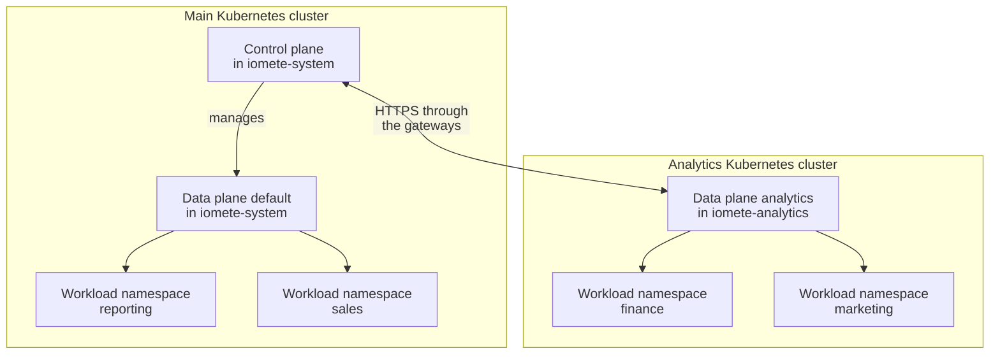

## Overview

In IOMETE 4.x, **one control plane manages multiple data planes**. Users sign in to one console to manage their domains, computes, and jobs. Each data plane runs the services that start, monitor, and connect to workloads in its Kubernetes environment.

These terms describe different things:

- A **data plane** is a set of IOMETE services with an ID, such as `default` or `analytics`. The control-plane release, a Helm release of the `iomete-data-plane-enterprise` chart, installs the control plane and the **default data plane**, `default`. Each **additional data plane** has its own runtime release of the `iomete-lakehouse-runtime` chart.
- A **service namespace** is the Kubernetes namespace that a release installs its services into. A **workload namespace** is a namespace listed in a release's `namespaces` value, where computes, Spark jobs, and Jupyter containers run.
- An IOMETE **domain**, such as `business`, groups users and their resources. A **namespace assignment** lets a domain run workloads in one namespace of one data plane.

A data plane is not a Kubernetes cluster or a namespace. Several data planes can share a cluster, and each data plane can manage several workload namespaces. Use a separate cluster when you need different infrastructure, another region, or a separate failure boundary, not just to add a data plane.

The examples on this page use this topology:



The control-plane release is named `data-plane`, and users open the console at `https://iomete.example.com`. The `default` data plane runs workloads in `reporting` and `sales`, the workload namespaces listed in the control-plane release's `namespaces` value, and in its service namespace, `iomete-system`. The `analytics` data plane has the runtime release `analytics` and the hostname `analytics.example.com`. The `business` domain is assigned `finance` and `marketing` on `analytics`, so a compute that a `business` user creates in `finance` runs in the analytics cluster.

If you run 3.16.x installations that share a database, read [Legacy Shared-Database Installations](#multi-cluster-setup-shared-global-database) first.

## Deployment Models

### Single Installation

The control-plane release installs the control plane and the `default` data plane together in the service namespace `iomete-system`. This is the default, and it fits most organizations. To run workloads in more namespaces of the same cluster, such as `reporting` and `sales`, add them to the release's `namespaces` value. You don't need another data plane for that; see [adding a namespace](./connect-namespace.md).

### One Control Plane with Multiple Data Planes

An additional data plane has its own runtime release of the `iomete-lakehouse-runtime` chart in its own service namespace, and enrolls with the existing control plane. The runtime release installs the data-plane agent, a gateway, the Spark Operator and its submit service, a Hive metastore, and the Spark History Server. In its service namespace and in each workload namespace, it also runs a Job Orchestrator worker and a Spark proxy server. It installs no console and no management services.

The additional data plane can run in the control plane's cluster or in another one. The example on this page uses another cluster:

| Purpose | Data Plane | Kubernetes Cluster | Namespace |
| --- | --- | --- | --- |
| Control plane and the default data plane | `default` | Main | `iomete-system` |
| Reporting workloads | `default` | Main | `reporting` |
| Sales workloads | `default` | Main | `sales` |
| Services of the additional data plane | `analytics` | Analytics | `iomete-analytics` |
| Finance workloads | `analytics` | Analytics | `finance` |
| Marketing workloads | `analytics` | Analytics | `marketing` |

The namespaces are siblings: `finance` and `marketing` are not nested inside `iomete-analytics`. If `analytics` ran in the main cluster, the namespaces would stay the same; only the cluster changes.

:::tip Choosing the Boundary
Use another namespace for a separate resource budget within a data plane. Use another data plane for a separate set of services or another Kubernetes cluster. A new namespace or data plane in the same cluster adds no nodes, so add worker capacity when you need more CPU or memory.
:::

### High Availability for the Control Plane

More data planes don't make the control plane highly available. For that, IOMETE 4.0 supports two control planes running side by side behind a load balancer and sharing one highly available PostgreSQL database. Both control-plane releases must use the same keys, so that each can read what the other wrote: create each key once as a Secret, and name it in both releases with `jwtSigning.existingSecret`, `secretEncryptionKey.existingSecret`, `socketSystemToken.existingSecret`, and `multiCluster.trustSecret.existingSecret`. Set each data plane's `multiCluster.controlPlaneAddress` to the load balancer's address rather than to one of the control planes. For operating the releases, see [Life Cycle Management](./life-cycle-management.mdx).

### Multiple Independent Installations

Separate IOMETE installations each have their own control plane, console, database, users, and workloads, and they share no state. Choose them when business units, regions, or environments such as development and production need independent administration and data. One installation's control plane doesn't manage another installation's data planes, and installing a second control-plane release doesn't enroll it as a data plane of the first.

## How It Works

1. **Enrolling.** When the data-plane agent starts, it sends the control plane a handshake with the data-plane ID, `selfUrl`, and `externalUrl`. The control plane checks the `selfUrl` host against its `multiCluster.trustedDomains`, calls the data plane back on `selfUrl`, and records the data plane.
2. **Reporting.** Every five seconds, the agent reports the data plane's namespaces, quotas, storage, and service health. It also forwards Kubernetes events for workloads.
3. **Assigning namespaces.** An administrator assigns data plane and namespace pairs to domains. The domain decides who can use the namespace; the namespace decides where Kubernetes runs the pods.
4. **Running workloads.** The control plane sends lifecycle operations, such as starting a compute, to the data plane's agent. Clients and the SQL Editor connect to computes through the data plane's `externalUrl`.

Calls between the planes pass through each side's gateway. The sending gateway adds a shared trust key to each call. When a call arrives through a public address, the receiving gateway rejects it unless it carries the same key.

A data plane shown as **Connected** has enrolled and is reporting. That doesn't prove that a compute can start, reach its storage, or accept a SQL connection, so the [verification steps](#verifying-the-data-plane) check those as well.

## Control Plane and Data Plane Resources {#global-vs-cluster-resources}

### Databases

The control plane keeps platform state in PostgreSQL: identities, configuration, workload records, SQL metadata, and catalog metadata. An additional data plane needs only one database, for its Hive metastore. It enrolls through the control plane's API, not through a shared database. See [Backend Databases](./backend-databases.md), and the metastore database in [Before You Begin](#before-you-begin).

### Services

| Control Plane | Each Data Plane |
| --- | --- |
| Console and management APIs | Agent and gateway |
| Identity, domains, and permission management | Kubernetes operations and workload events |
| Compute and job definitions | Spark Operator and workload execution |
| SQL Editor and query management | Compute connection endpoints |
| Platform and catalog state | Metastore, Spark History Server, and Job Orchestrator workers |

The `default` data plane's services run in `iomete-system`, next to the control plane. See [Deployment Architecture](./architecture-deployment.md#service-inventory) for where each service runs.

## Configuration

### Single Instance (Default)

The control-plane release includes the `default` data plane while `defaultDataPlane.enabled` is `true`, which is the default. The `default` data plane's workload namespaces, `reporting` and `sales` in the example, belong in that release's `namespaces` list.

<details>
<summary>Running all user workloads on additional data planes</summary>

The control-plane release supports `defaultDataPlane.enabled: false` when every user workload should run on additional data planes. The console then lists no data plane until one enrolls. The release still runs a Spark Connect driver in `iomete-system`, with the Spark Operator and metastore that it needs, because the database explorer reads metadata from it.

</details>

### Additional Data Plane {#multi-cluster-setup}

These runtime-release values identify the data plane and connect it to the control plane:

| Setting | Purpose |
| --- | --- |
| `multiCluster.dataPlaneName` | The data-plane ID, `analytics`: lowercase letters, digits, and hyphens, unique on the control plane. |
| `multiCluster.controlPlaneAddress` | The control plane's URL, where users open the console: `https://iomete.example.com`. |
| `multiCluster.selfUrl` | The URL the control plane calls this data plane on: `https://analytics.example.com`. Its host must match the control-plane release's `multiCluster.trustedDomains`. |
| `multiCluster.externalUrl` | The URL that clients and the SQL Editor use for computes on this data plane. It defaults to `selfUrl`. |
| `multiCluster.trustSecret` | The shared trust key from the control plane. `existingSecret` names a Secret that holds it, `analytics-plane-trust` here. |
| `namespaces` | The workload namespaces, `finance` and `marketing`. The chart adds the service namespace automatically. |
| `database` | The metastore's PostgreSQL database, named `<prefix>metastore_db`: `analytics_metastore_db` here. |
| `storage` | Object storage for this data plane's workloads: the bucket `analytics-lakehouse` here. |

The control plane keeps the first `selfUrl` and `externalUrl` it receives, so choose them before you install. See the warning in [Installing the Runtime Release](#applying-the-configuration).

The data plane's hostname, `analytics.example.com`, must serve TLS on port 443 with HTTP/2 and route three groups of paths to Services in `iomete-analytics`:

| Path Prefix | Service and Port | Used By |
| --- | --- | --- |
| `/spark.connect.` and `/arrow.flight.protocol.FlightService` | `iom-gateway`, port 8081 (HTTP/2) | Spark Connect and Arrow Flight clients, and the SQL Editor |
| `/cross-plane/` | `iom-gateway-cross-ingress`, port 8083 | The control plane, when `selfUrl` is this hostname |
| All other paths | `iom-gateway`, port 80 | JDBC and ODBC connections, and Jupyter containers |

In 4.0.1 and 4.0.2, the SQL Editor connects to a compute on an additional data plane at the `externalUrl` host on port 443 over TLS, whatever scheme or port the URL names.

When the data plane runs in the control plane's cluster, `selfUrl` can be the in-cluster address `http://iom-gateway-cross-ingress.iomete-analytics.svc.cluster.local:8083` instead. The control plane's default `trustedDomains` already allow it, and the `/cross-plane/` route isn't needed. Keep `externalUrl` on the public HTTPS hostname.

When several data planes share a cluster, give each one its own service namespace and workload namespaces: two releases must not manage the same namespace. Different clusters can reuse namespace names, so always identify a namespace together with its data plane.

## Installing an Additional Data Plane

This procedure installs the `analytics` data plane in the service namespace `iomete-analytics` of the analytics cluster, and enrolls it with the control plane at `https://iomete.example.com`. It starts from a working control-plane release, `data-plane` in `iomete-system`. When you finish, the console shows `analytics` as **Connected**, the `business` domain can use `finance` and `marketing`, and a compute in `finance` answers a query.

If `analytics` shares the control plane's cluster, follow the same steps with one Kubernetes context; the steps point out the differences.

### Before You Begin

Prepare the following:

- **Access.** You need `kubectl` and Helm access to both clusters, and an IOMETE administrator account. In the analytics cluster, you need permission to create namespaces, Secrets, RBAC resources, and a MutatingWebhookConfiguration, and CustomResourceDefinitions if the cluster doesn't have the Spark Operator CRDs yet. If a cluster administrator must create the cluster-wide resources, follow [Option 2: Have an Administrator Create Them](./on-prem/install.md#option-2-have-an-administrator-create-them) with this chart's `templates/service-account.yaml`, `templates/spark-operator-webhook.yaml`, and `charts/operator-crds/crds/`.
- **A compatible chart version.** Install the runtime chart at the same version as the control-plane release. IOMETE releases both charts together under one version number. A data plane from another release can enroll and still fail later, for example when a compute authenticates.
- **Network paths.**
  - The analytics cluster reaches `https://iomete.example.com` on port 443. The agent, the Job Orchestrator workers, and Spark drivers call the control plane through the runtime release's gateway.
  - The main cluster reaches `https://analytics.example.com` on port 443. The control plane's gateway calls `selfUrl` there, and `iom-sql` connects to computes for the SQL Editor.
  - Clients that connect to computes reach `https://analytics.example.com`.
- **DNS and TLS.** You need a DNS record that points `analytics.example.com` at the analytics cluster's ingress, and a TLS certificate for that name. The control plane verifies the certificate. For a private CA, add the CA to the control-plane release's truststore, both in `truststore.jks` and in the `javaTrustStore.caCertFileName` bundle; see [Custom Java Truststore](./truststore.md). If `iomete.example.com` uses a private CA, configure `javaTrustStore` the same way in the runtime release.
- **A metastore database.** The data plane's metastore keeps its schema in the PostgreSQL database `<prefix>metastore_db`. The chart creates the schema but not the database. Both charts default `database.prefix` to `iomete_`, so on the control plane's PostgreSQL server the default points `analytics` at the control plane's own `iomete_metastore_db`, and both data planes share one `spark_catalog`. This example gives `analytics` its own database by setting the prefix `analytics_`. As a PostgreSQL administrator, create the database and the role that owns it:

  ```bash
  psql "host=postgresql.example.com user=postgres dbname=postgres" \
    -c "CREATE ROLE analytics_metastore LOGIN PASSWORD '<metastore-password>'" \
    -c "CREATE DATABASE analytics_metastore_db OWNER analytics_metastore"
  ```

  Share the control plane's metastore only on purpose, and only when both data planes can read the same object storage.
- **Object storage.** You need a bucket for the data plane, `analytics-lakehouse` here, and credentials that can write to it: the installation creates a folder in it. The 4.0.1 and 4.0.2 runtime charts support S3-compatible storage (`s3_compatible`) and Amazon S3 (`aws_s3`) only, and the installation stops on other storage types. For Amazon S3, also set `storage.region` and `cloud.provider: aws`, and grant access through an IAM role in `serviceAccount.annotations` instead of keys.
- **Registry access.** The clusters pull images from `iomete.azurecr.io/iomete`. For a private registry, set `docker.repo`, create the pull Secret in `iomete-analytics`, `finance`, and `marketing`, and list it in `docker.imagePullSecrets`.
- **The truststore Secret for computes.** If the control-plane release enables `javaTrustStore`, also create its Secret (`java-truststore` unless `javaTrustStore.secretName` names another) in `finance` and `marketing`. Computes on every data plane mount it.
- **SQL Editor V2.** The last check runs a query from the console. In 4.0.1 and 4.0.2, the SQL Editor queries computes in another cluster only when the **SQL Editor V2** feature flag is on, and it is off by default. See [SQL Editor V2 Feature Flag](/resources/user-guide/feature-flags/sql-editor-v2) for what it requires.

### Setting the Contexts and Chart Version

Set the `kubectl` contexts of the two clusters, and read the control-plane release's chart version. `kubectl config get-contexts` lists your context names.

```bash
# Replace with your context names. If analytics shares the control plane's
# cluster, set both variables to the same context.
export CP_CONTEXT=main-cluster
export DP_CONTEXT=analytics-cluster

helm list --kube-context "$CP_CONTEXT" --namespace iomete-system --filter '^data-plane$'
```

The `CHART` column shows the version:

```text
NAME        NAMESPACE      REVISION  UPDATED                                  STATUS    CHART                               APP VERSION
data-plane  iomete-system  12        2026-11-02 14:03:51.284516 +0000 UTC     deployed  iomete-data-plane-enterprise-4.0.2  4.0.2
```

Use the same version for the runtime chart, and check that the repository has it:

```bash
export IOMETE_VERSION=4.0.2
helm repo add iomete https://chartmuseum.iomete.com
helm repo update iomete
helm search repo iomete/iomete-lakehouse-runtime --version "$IOMETE_VERSION"
```

Expected output:

```text
NAME                             CHART VERSION  APP VERSION  DESCRIPTION
iomete/iomete-lakehouse-runtime  4.0.2          4.0.2        IOMETE lakehouse runtime used for multi-cluster...
```

To review every value that the chart accepts, run `helm show values iomete/iomete-lakehouse-runtime --version "$IOMETE_VERSION"`.

### Allowing the Data Plane's Address

Skip this step if `selfUrl` is the in-cluster `.svc.cluster.local` address.

The control plane accepts a handshake only when the `selfUrl` host matches an entry in its `multiCluster.trustedDomains`: an exact host, `*.example.com` for one subdomain level, or `**.example.com` for any depth. In the control-plane release's values file, `data-plane-values.yaml` here, add the data plane's host. Keep the default entry, because the `default` data plane enrolls on an in-cluster address:

```yaml title="data-plane-values.yaml (excerpt)"
multiCluster:
  trustedDomains:
    - "**.svc.cluster.local"
    - "analytics.example.com"
```

If you don't have the values file, save the release's current values to it first:

```bash
helm get values data-plane --kube-context "$CP_CONTEXT" --namespace iomete-system \
  --output yaml > data-plane-values.yaml
```

Then upgrade the control-plane release at its current chart version:

```bash
helm upgrade data-plane iomete/iomete-data-plane-enterprise \
  --kube-context "$CP_CONTEXT" \
  --namespace iomete-system \
  --version "$IOMETE_VERSION" \
  --values data-plane-values.yaml
kubectl --context "$CP_CONTEXT" rollout status deployment/iom-core --namespace iomete-system
```

The services that read these settings at startup restart: `iom-core`, `iom-cluster`, `iom-identity`, and `iom-sql`. The last command prints `deployment "iom-core" successfully rolled out`.

### Creating the Namespaces and Secrets

Create the service namespace and the workload namespaces in the analytics cluster. The [network policies](./network-policies.md) select IOMETE namespaces by the `iomete.com/managed` label:

```bash
for namespace in iomete-analytics finance marketing; do
  kubectl --context "$DP_CONTEXT" create namespace "$namespace"
  kubectl --context "$DP_CONTEXT" label namespace "$namespace" iomete.com/managed=true
done
```

Copy the control plane's trust key into a Secret in `iomete-analytics`. The command passes the key from one cluster to the other without printing it:

```bash
kubectl --context "$CP_CONTEXT" get secret iomete-plane-trust-secret \
  --namespace iomete-system \
  --output jsonpath='{.data.plane-trust-secret\.conf}' \
  | base64 -d \
  | kubectl --context "$DP_CONTEXT" create secret generic analytics-plane-trust \
      --namespace iomete-analytics \
      --from-file=plane-trust-secret.conf=/dev/stdin
```

The control-plane release creates `iomete-plane-trust-secret` and keeps it across upgrades. If the release sets `multiCluster.trustSecret.existingSecret`, read the Secret it names instead. If it sets `multiCluster.trustSecret.enabled: false`, skip this Secret, and set the same value in the runtime release. Every plane must use the same key, or calls between the planes fail with HTTP 401.

Create a Secret for the metastore password and the storage secret key. Replace the placeholders with the `analytics_metastore` role's password and the secret of the storage access key:

```bash
kubectl --context "$DP_CONTEXT" create secret generic analytics-credentials \
  --namespace iomete-analytics \
  --from-literal=database-password='<metastore-password>' \
  --from-literal=storage-secret-key='<storage-secret-key>'
```

### Publishing the Data Plane's Hostname

Route `analytics.example.com` as described in [Additional Data Plane](#multi-cluster-setup). With the Istio ingress gateway from [Configure Ingress](./configure-ingress.md), a Gateway and a VirtualService provide the routes. First create the TLS Secret `analytics-tls` in `istio-system`, as that page describes for its `tls-secret`. Then save this manifest and apply it:

```yaml title="analytics-ingress.yaml"
apiVersion: networking.istio.io/v1beta1
kind: Gateway
metadata:
  name: analytics
  namespace: istio-system
spec:
  selector:
    istio: ingress
  servers:
    - hosts:
        - analytics.example.com
      port:
        name: https-analytics
        number: 443
        protocol: HTTPS
      tls:
        mode: SIMPLE
        credentialName: analytics-tls
---
apiVersion: networking.istio.io/v1beta1
kind: VirtualService
metadata:
  name: analytics
  namespace: iomete-analytics
spec:
  gateways:
    - istio-system/analytics
  hosts:
    - analytics.example.com
  http:
    # Spark Connect and Arrow Flight: gRPC over HTTP/2.
    - match:
        - uri:
            prefix: /spark.connect.
        - uri:
            prefix: /arrow.flight.protocol.FlightService
      route:
        - destination:
            host: iom-gateway
            port:
              number: 8081
    # Calls from the control plane to selfUrl.
    - match:
        - uri:
            prefix: /cross-plane/
      route:
        - destination:
            host: iom-gateway-cross-ingress
            port:
              number: 8083
    # Everything else, such as JDBC connections and Jupyter containers.
    - route:
        - destination:
            host: iom-gateway
            port:
              number: 80
```

```bash
kubectl --context "$DP_CONTEXT" apply --filename analytics-ingress.yaml
```

With another ingress controller, configure the same routes, TLS, and HTTP/2. The routes answer once the runtime release is installed.

### Writing the Values File

Save the runtime release's values as `analytics-values.yaml`. Replace the database host, the storage endpoint, and the storage access key with yours:

```yaml title="analytics-values.yaml"
multiCluster:
  # The data-plane ID: lowercase letters, digits, and hyphens.
  dataPlaneName: analytics
  # The control plane's URL, where users open the console.
  controlPlaneAddress: https://iomete.example.com
  # The URL the control plane calls this data plane on.
  selfUrl: https://analytics.example.com
  # The URL that clients and the SQL Editor use for computes.
  externalUrl: https://analytics.example.com
  trustSecret:
    # The Secret with the control plane's trust key.
    existingSecret: analytics-plane-trust

# Workload namespaces. The chart adds the service namespace, iomete-analytics.
namespaces:
  - finance
  - marketing

# The metastore database: <prefix>metastore_db, here analytics_metastore_db.
database:
  host: postgresql.example.com
  port: "5432"
  user: analytics_metastore
  passwordSecret:
    name: analytics-credentials
    key: database-password
  prefix: analytics_

storage:
  type: s3_compatible
  bucketName: analytics-lakehouse
  s3CompatibleSettings:
    endpoint: https://s3.example.com
    accessKey: analytics-lakehouse-writer
    secretKeySecret:
      name: analytics-credentials
      key: storage-secret-key

serviceAccount:
  create: true
webhook:
  create: true
# false if the Spark Operator CRDs already exist in this cluster.
crds:
  create: true
```

The last three settings default to `false`, because they create resources that not every Helm user can create:

| Setting | Set It To |
| --- | --- |
| `serviceAccount.create` | `true`, so that Helm creates `lakehouse-service-account` and its RBAC in `iomete-analytics`, `finance`, and `marketing`. Leave it `false` only if a cluster administrator creates them: no pod starts without them. |
| `webhook.create` | `true`, so that Helm creates this data plane's Spark Operator webhook, `spark-operator-iomete-analytics`, scoped to its own namespaces. A control plane in the same cluster has its own webhook. |
| `crds.create` | `true` in a cluster without the Spark Operator CRDs. Keep it `false` when they already exist, for example because the control-plane release created them in the same cluster. Helm creates CRDs only on a release's first installation and never updates them. With Helm 4, `true` fails the installation if an existing CRD differs from the chart's. |

If `analytics` shares the control plane's cluster, set `crds.create: false`. You can also set `selfUrl` to the in-cluster address from [Additional Data Plane](#multi-cluster-setup).

### Installing the Runtime Release {#applying-the-configuration}

:::warning Check the Addresses Before You Install
The control plane records `selfUrl` and `externalUrl` at the data plane's first successful enrollment and keeps them. A later `helm upgrade` with other values doesn't change them, and neither the console nor the API can edit them. Before you install, check that both URLs are final, resolve from the main cluster, and use HTTPS with a certificate that the control plane trusts.

If a data plane enrolled with a wrong address: in 4.0.1, contact IOMETE support. From 4.0.2, you can remove it and install it again. Stop its workloads, remove its namespaces from every domain, and uninstall the runtime release. When it shows **Disconnected**, remove it on the **Data Planes** page, or with `DELETE /api/v1/admin/multi-cluster/data-planes/analytics`. The control plane refuses while the data plane is connected or still has namespaces assigned.
:::

Install the runtime release in the analytics cluster:

```bash
helm install analytics iomete/iomete-lakehouse-runtime \
  --kube-context "$DP_CONTEXT" \
  --namespace iomete-analytics \
  --version "$IOMETE_VERSION" \
  --values analytics-values.yaml
```

Helm first runs the `init-job` Job, which checks the storage and database settings, writes the metastore and Spark configuration, and creates a folder in the bucket. Then it reports `STATUS: deployed`. If the installation fails on `init-job`, read the job's log, which names the problem:

```bash
kubectl --context "$DP_CONTEXT" logs job/init-job --namespace iomete-analytics
```

Fix the values, remove the failed release, and run the `helm install` command again:

```bash
helm uninstall analytics --kube-context "$DP_CONTEXT" --namespace iomete-analytics
```

The data plane hasn't enrolled at that point, because the agent starts only after the job succeeds. For later changes to the release, run `helm upgrade` with the same options as `helm install`.

### Verifying the Data Plane

1. **The pods are ready.** Wait for the deployments in all three namespaces, then list the service namespace's pods:

   ```bash
   for namespace in iomete-analytics finance marketing; do
     kubectl --context "$DP_CONTEXT" wait deployment --all --for=condition=Available \
       --namespace "$namespace" --timeout=10m
   done
   kubectl --context "$DP_CONTEXT" get pods --namespace iomete-analytics
   ```

   The `init-job` pod is `Completed`, and every other pod is `Running` and ready. The name suffixes differ:

   ```text
   NAME                                                  READY   STATUS      RESTARTS   AGE
   init-job-7xk2p                                        0/1     Completed   0          6m
   iom-gateway-5d8f7c9b6d-2lq9w                          1/1     Running     0          5m
   iomete-lakehouse-agent-6b7c9d8f5-k8s2v                1/1     Running     0          5m
   metastore-7c6d5f8b9-p4x7z                             1/1     Running     0          5m
   prefect-worker-iomete-analytics-6f9b8c7d5-q2w4e       2/2     Running     0          5m
   spark-history-5b8c7d6f9-t6y8u                         1/1     Running     0          5m
   spark-operator-7d6c5b8f9-m3n5b                        1/1     Running     0          5m
   spark-operator-submit-service-8c7b6d5f4-v7c9x         1/1     Running     0          5m
   spark-proxy-server-iomete-analytics-9d8c7b6f5-z1x3c   1/1     Running     0          5m
   ```

   `finance` and `marketing` each run a `prefect-worker-` pod and a `spark-proxy-server-` pod.

2. **The agent enrolled.** Search the agent's log for the handshake:

   ```bash
   kubectl --context "$DP_CONTEXT" logs --namespace iomete-analytics \
     --selector service=iomete-lakehouse-agent --tail=-1 --prefix | grep Handshake
   ```

   The selector reads every agent replica: from 4.0.2 the chart runs two, and only the one that holds the leader lease enrolls. Expected output, prefixed with that pod's name:

   ```text
   [pod/iomete-lakehouse-agent-7c9f6d8b5-q2w4x/lakehouse-agent] {"level":"info","time":"2026-11-07T10:12:41.538Z","logger":"handshake","caller":"enroll/enroll.go:59","msg":"Handshake succeeded","dataPlaneId":"analytics","controlPlaneId":"<control-plane-id>"}
   ```

   A `Handshake failed, will retry` line or two before it is normal while the release starts. If the agent keeps logging `Handshake failed, will retry` instead, its `reason` field names the HTTP status. See [Troubleshooting](#troubleshooting).

3. **The console shows the data plane.** In the admin console, open **Data Planes** (`https://iomete.example.com/admin/data-planes`). The `analytics` row shows the address `https://analytics.example.com`, the status **Connected**, and the runtime version, here `4.0.2`. If the agent stops reporting for about 30 seconds, the status changes to **Disconnected**.

4. **The namespaces are discovered.** In the admin console, open **Domains**, select `business`, and open the **Namespaces** tab. Select **Add Namespace**. The list groups namespaces by data plane: `reporting`, `sales`, and `iomete-system` under `default`, and `finance`, `marketing`, and the service namespace `iomete-analytics` under `analytics`. Select `finance` and `marketing`, and then select **Add**. The tab lists both, with `analytics` in the **Data plane** column. The control plane reads this list from the agent at `selfUrl`, so it also proves that the control plane can reach the data plane.

5. **A compute runs a query.** In the `business` domain, create a compute named `finance-check`, and under **Namespace**, choose `finance` in the `analytics` group. See [Creating a Cluster](/resources/user-guide/compute-clusters/creating-clusters). When the compute's status is **Active**, check where its pods run:

   ```bash
   kubectl --context "$DP_CONTEXT" get pods --namespace finance
   ```

   The driver pod `cc-finance-check-driver` is `Running`, next to the namespace's worker and proxy pods. Executor pods, named `cc-finance-check-...-exec-N`, appear when the compute has executors:

   ```text
   NAME                                         READY   STATUS    RESTARTS   AGE
   cc-finance-check-5f6c8d9e0a1b2c3d-exec-1     1/1     Running   0          1m
   cc-finance-check-driver                      1/1     Running   0          2m
   prefect-worker-finance-7d9c6b5f4-x2k8p       2/2     Running   0          25m
   spark-proxy-server-finance-6c8d7f9b5-q4m7n   1/1     Running   0          25m
   ```

   Open the SQL Editor, select the `finance-check` compute, and run `SELECT 1`. The result is one row with the value `1`.

### Troubleshooting

#### Calls Fail with HTTP 401

The agent logs `Handshake failed, will retry` with the reason `control plane answered 401 for /api/v1/multi-cluster/handshake`, or the data plane changes to **Disconnected**. A gateway rejected a call between the planes because the trust keys differ. Compare the two Secrets without printing them:

```bash
kubectl --context "$CP_CONTEXT" get secret iomete-plane-trust-secret --namespace iomete-system \
  --output jsonpath='{.data.plane-trust-secret\.conf}' | sha256sum
kubectl --context "$DP_CONTEXT" get secret analytics-plane-trust --namespace iomete-analytics \
  --output jsonpath='{.data.plane-trust-secret\.conf}' | sha256sum
```

If the hashes differ, replace the data plane's Secret with the control plane's key. Then restart the gateway, which reads the key only at startup:

```bash
kubectl --context "$CP_CONTEXT" get secret iomete-plane-trust-secret \
  --namespace iomete-system \
  --output jsonpath='{.data.plane-trust-secret\.conf}' \
  | base64 -d \
  | kubectl --context "$DP_CONTEXT" create secret generic analytics-plane-trust \
      --namespace iomete-analytics \
      --from-file=plane-trust-secret.conf=/dev/stdin \
      --dry-run=client --output yaml \
  | kubectl --context "$DP_CONTEXT" replace --filename -
kubectl --context "$DP_CONTEXT" rollout restart deployment/iom-gateway --namespace iomete-analytics
```

If the hashes match, check that `multiCluster.trustSecret.enabled` has the same value in both releases.

#### The Handshake Is Rejected

The agent logs `Handshake failed, will retry` with another status in its reason. The control plane logs the cause:

```bash
kubectl --context "$CP_CONTEXT" logs deployment/iom-core --namespace iomete-system \
  | grep 'handshake rejected'
```

| Status in the Agent Log | Control-Plane Log | Fix |
| --- | --- | --- |
| `403` | `reason=untrusted_domain` | Add the `selfUrl` host to the control plane's `multiCluster.trustedDomains`. See [Allowing the Data Plane's Address](#allowing-the-data-planes-address). |
| `400` | `reason=unreachable` | The control plane couldn't call `selfUrl` back. Check DNS and firewalls from the main cluster, the `/cross-plane/` route, and the certificate trust. |
| `409` | `reason=address_taken` | Another data plane enrolled with this `selfUrl` first. Use another hostname. |
| `502` or `504` | No entry | The data plane's gateway can't reach `controlPlaneAddress`. Check DNS and firewalls from the analytics cluster, and the control plane's certificate. |

To check the `/cross-plane/` route, call it without the trust key:

```bash
curl -s -o /dev/null -w '%{http_code}\n' https://analytics.example.com/cross-plane/api/v1/data-plane/ping
```

`401` means that the route reaches the data plane's cross-plane listener, which rejects the call because it has no trust key. `302` means that the route is missing: the call reached the public listener, which redirects to the console.

After you fix the cause, the agent retries on its own, waiting up to five minutes between attempts. To retry at once, restart the agent:

```bash
kubectl --context "$DP_CONTEXT" rollout restart deployment/iomete-lakehouse-agent --namespace iomete-analytics
```

#### Queries Fail on a Connected Data Plane

The data plane is **Connected** and the compute is **Active**, but queries fail:

- If the SQL Editor reports `Compute 'finance-check' runs on data plane 'analytics', which this SQL editor cannot reach. The SQL Editor V2 rollout flag is required to query it.`, turn on the **SQL Editor V2** feature flag.
- Check TLS and HTTP/2 on the external hostname, from the main cluster's network as well as from clients:

  ```bash
  curl -sS -o /dev/null -w '%{http_version} %{http_code}\n' --http2 https://analytics.example.com/
  ```

  The expected output is `2 302`. `1.1 302` means that HTTP/2 isn't negotiated, which breaks Spark Connect and Arrow Flight. An error such as `curl: (60) SSL certificate problem: unable to get local issuer certificate` means that the certificate isn't trusted.
- Check that the gRPC paths route to `iom-gateway` on port 8081, and that `externalUrl` names a hostname with TLS on port 443.

Re-enrolling the data plane doesn't fix these paths.

#### A Compute Doesn't Start

If the driver pod stays in `ContainerCreating`, read its events:

```bash
kubectl --context "$DP_CONTEXT" describe pod cc-finance-check-driver --namespace finance
```

An event such as `MountVolume.SetUp failed for volume "truststore-volume" : secret "java-truststore" not found` means that `finance` is missing the truststore Secret that the control plane gives every compute. An `ErrImagePull` status points to registry access. See [Before You Begin](#before-you-begin).

## Behavior and Expectations

- One control plane gives users one view of all its data planes. Workloads still run in the data plane and namespace selected for them.
- Adding a data plane doesn't copy computes, move running jobs, replicate object storage, or set up failover.
- Data planes in one cluster share its nodes and its failure risks. Quotas, node placement, network policies, and separate clusters provide different kinds of isolation.
- Each data plane depends on its connection to the control plane. A disconnected data plane stops receiving management operations, even if some existing workload pods keep running.
- The control plane's databases and services need their own availability and backup plan. See [High Availability for the Control Plane](#high-availability-for-the-control-plane).

## Legacy Shared-Database Installations {#multi-cluster-setup-shared-global-database}

Only the 3.16.x charts had the `clusterDatabase` value; chart 3.17.0 removed it. With it, several full IOMETE installations shared one platform database, `database`, for users, catalogs, and domains, while each kept its own control plane, console, and `clusterDatabase` for Spark and Kubernetes records. Sharing database records is not the same as one control plane managing several data planes.

A 3.16.x values file could look like this:

```yaml title="3.16.x structure only. Not a 4.x configuration."
database:
  host: postgresql-global.example.com
  # Shared-database connection settings

clusterDatabase:
  host: postgresql-local.example.com
  # Installation-local connection settings
```

The 4.x charts ignore `clusterDatabase`, so don't add it to a 4.x values file, and don't treat a chart upgrade as a migration of a shared-database installation.

### Moving from a Legacy Topology {#roadmap}

A single control plane is part of the 4.x architecture rather than a future roadmap item. Before you change a shared-database installation, list its chart versions, which installation owns each database, its catalogs and storage, and where its workloads run. Then plan the move to one control plane with additional data planes. Don't repoint databases or reinstall releases only to make an old configuration look like the examples on this page.

## Related Documentation

- [Architecture Overview](../getting-started/architecture.md)
- [Scalability](../getting-started/scalability.md)
- [Deployment Architecture](./architecture-deployment.md)
- [On-Premises Deployment Guide](./on-prem/install.md)
- [Adding a Namespace](./connect-namespace.md)
- [Configure Ingress](./configure-ingress.md)
- [Custom Java Truststore](./truststore.md)
- [Backend Databases](./backend-databases.md)
- [Network Policies](./network-policies.md)
- [Life Cycle Management](./life-cycle-management.mdx)
