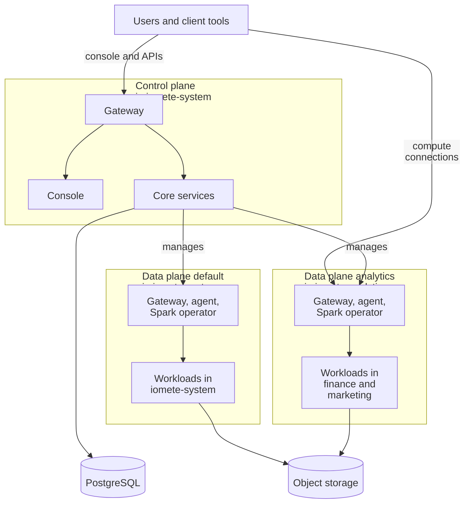

import DemoCta from '@site/src/components/DemoCta';

IOMETE is a data lakehouse platform built on [Apache Spark](https://spark.apache.org/), [Apache Iceberg](https://iceberg.apache.org/), and [Kubernetes](https://kubernetes.io/). It runs on Kubernetes and stores table data in object storage. From a single console, you can manage compute clusters, run Spark jobs, query data with SQL, browse the data catalog, and enforce security policies.

## High-Level Architecture

IOMETE separates **management**, **execution**, and **storage**. In the 4.x architecture, one control plane manages one or more data planes. A data plane can manage several Kubernetes namespaces, and several data planes can run in the same Kubernetes cluster. You do not need a new cluster for every data plane.

| Component | Responsibility | Example |
| --- | --- | --- |
| **Control plane** | Provides the console, APIs, identity, catalog, and workload management | One console for all your teams and data planes |
| **Data plane** | Runs the services that create, monitor, and connect to workloads in its Kubernetes cluster | `default`, installed with the control plane, and `analytics`, an additional data plane |
| **Kubernetes namespace** | Contains pods and other Kubernetes resources; can have its own quotas and access rules | `finance` and `marketing`, both managed by `analytics` |
| **IOMETE domain** | Organizes members, permissions, and platform resources | A `business` domain assigned namespaces on one or more data planes |
| **Storage** | Holds table data and platform files; PostgreSQL holds platform metadata | Object storage for Iceberg tables, PostgreSQL for configuration |

A default installation contains the control plane and a **default data plane** with the ID `default`, both installed by one Helm release. Each **additional data plane** runs its own data-plane services, installed by its own Helm release, and registers with the control plane. It can be in the same cluster, another data center, or another cloud region. [Terms Used in These Guides](../deployment/architecture-deployment.md#terms-used-in-these-guides) defines these terms.

The diagram shows one installation with the default data plane and an additional data plane, `analytics`:

The arrows show which component calls which, not nesting in Kubernetes. The control plane and the default data plane share the service namespace `iomete-system`. The `analytics` data plane's services run in `iomete-analytics`, and its workloads run in the workload namespaces `finance` and `marketing`. All of these namespaces are siblings in Kubernetes. Client tools, such as BI tools, SQL clients, dbt, and Spark Connect applications, reach the default data plane's computes through the control-plane gateway and the `analytics` computes through that plane's gateway. You can place everything in one cluster or put the data planes in separate clusters.

For example, a `business` domain can use both `finance` and `marketing` on `analytics`. A compute created in `marketing` runs there. Assigning a namespace to a domain doesn't create another data plane or move existing workloads. See [Multi-Cluster Setup](../deployment/multi-cluster-setup.mdx) for topology choices.

## Platform Services

The control plane's services provide the shared console and management APIs. Each data plane runs its own services: an agent, a gateway, the Spark operator, a Hive metastore, and a Spark History Server. Use the same IOMETE version for the control plane and all its data planes; see [Release Versions](../deployment/architecture-deployment.md#release-versions).

### IOMETE Gateway

The control-plane [Nginx](https://nginx.org/) gateway routes console and management API requests to the right service. Each data plane also has a gateway for its compute connections and for calls between the planes. Spark Connect and Arrow Flight use gRPC, and notebooks also need WebSocket support, so the ingress in front of each gateway must support the protocols you use. See [Gateway Routing](../deployment/architecture-deployment.md#gateway-routing) for the routes.

### Core Service

The Core Service owns platform-wide settings and cross-cutting concerns:

- Data plane and system configuration
- Authentication and access tokens
- Authorization checks
- Node type and volume management
- Spark settings
- S3 browser for object storage exploration
- Spark History Server proxy (the Spark History UI is accessible through this service)
- Integration settings (notifications, external services)

### Cluster Service

The Cluster Service manages workload definitions and lifecycle operations across the registered data planes:

- [Compute clusters](/resources/user-guide/compute-clusters/overview): create, start, stop, delete
- [Spark batch and streaming jobs](/resources/user-guide/spark-jobs/creating-spark-job): submission, monitoring, scheduling
- [Jupyter containers](/resources/user-guide/notebook/jupyter-containers): lifecycle management
- [Docker registries](/resources/user-guide/private-docker-registry) and image management
- Namespace and [secrets](/resources/user-guide/secrets) management
- [Event stream](/resources/user-guide/event-stream) definitions

### Data Plane Agent

Each data plane's agent registers it with the control plane, reports its namespaces and health, and forwards Kubernetes events. The control plane calls the agent to run Kubernetes operations and to read workload status in that plane. With the default log settings, it also reads workload logs through the agent; see [Logging](../deployment/architecture-deployment.md#logging). This is how one console manages workloads across clusters without a full control plane in each one.

### Identity Service

Controls who can access the platform and what they're allowed to see or change:

- [User](/resources/user-guide/users) and [group management](/resources/user-guide/groups)
- [Role management](/resources/user-guide/roles) and member assignment
- [LDAP](/resources/user-guide/ldap-configuration), [SAML](/resources/user-guide/single-sign-on/saml), and [OIDC](/resources/user-guide/single-sign-on/oidc) integrations for [single sign-on](/resources/user-guide/single-sign-on)
- Policy management for [data security](/resources/user-guide/data-security/overview) (row-level filtering, [column masking](/resources/user-guide/data-security/data-masking))
- Bundle-based authorization

### SQL Service

Provides the backend for the [SQL Editor](/resources/user-guide/sql-editor/overview), where most day-to-day querying happens:

- SQL [query execution](/resources/user-guide/sql-editor/running-queries) and [result management](/resources/user-guide/sql-editor/query-results)
- [Worksheets](/resources/user-guide/sql-editor/worksheets), [workspaces](/resources/user-guide/sql-editor/workspaces), and folder organization
- [Git integration](../integrations/git/git-integration.md) for version-controlled SQL
- [Query history](/resources/user-guide/sql-editor/query-history) and monitoring
- [Database explorer](/resources/user-guide/sql-editor/database-explorer) for schema and catalog browsing
- [Dashboards](/resources/user-guide/sql-editor/dashboards)

In 4.0.1 and 4.0.2, the SQL Editor can query a compute on a data plane in another Kubernetes cluster only when [SQL Editor V2](/resources/user-guide/feature-flags/sql-editor-v2) is turned on.

### Catalog Service

The backend for the [Data Catalog](/resources/user-guide/data-catalog/overview). Teams use it to discover and govern data:

- Full-text [search](/resources/user-guide/data-catalog/search) and browsing (backed by [Typesense](https://typesense.org/))
- [Table metadata](/resources/user-guide/data-catalog/table-details) and descriptions
- [Classification tags](/resources/user-guide/data-catalog/classification-tags) and governance policies
- [Access permissions](/resources/user-guide/data-catalog/access-permissions)

### Iceberg REST Catalog Service

Implements the [Apache Iceberg REST Catalog](https://iceberg.apache.org/rest-catalog-spec/) specification so that compatible engines can access Iceberg table metadata. Catalog authorization and the data-security policies enforced by IOMETE compute work together to control access. The catalog manages metadata; Spark reads and writes table files in object storage.

### Platform Health {#health-check-service}

The Core Service checks the platform's services every 10 seconds and keeps 48 hours of results, together with the status that each data plane reports. The console groups the results into control-plane services and one group per data plane, so a disconnected data plane doesn't look like a failure of every plane. In 4.x, health monitoring is part of Core, not a separate `iom-health-check` deployment. See [Health Check](/resources/user-guide/monitoring/health-check).

## Spark Infrastructure

Spark is the execution engine for computes and Spark jobs. Each data plane runs its own Spark operator, Hive metastore, and Spark History Server. The components below manage how Spark workloads are created, submitted, and tracked.

### Spark Operator

A Kubernetes operator that manages Spark workloads through three components:

- **Controller**: watches for SparkApplication CRDs and manages the lifecycle of Spark pods
- **Webhook**: applies runtime settings to Spark pods during Kubernetes admission
- **Submit Service**: handles submission of Spark applications to Kubernetes, with configurable parallelization and queueing

### Spark Connect (Internal)

An internal Spark cluster used for metadata extraction and database explorer operations. It runs in the control-plane release and isn't user-facing. Instead, it powers features like schema browsing in the SQL Editor and Data Catalog.

### Spark History Server

Reads Spark event logs from object storage and shows job history and performance details. Each data plane runs its own, and the console reaches it through the Core Service proxy.

## Workloads

You create computes, Spark jobs, and Jupyter containers in the console or through the API, choosing a data plane and one of the namespaces assigned to your domain. The control plane asks that data plane to create the Kubernetes resources there, and Spark workloads run through the data plane's Spark operator.

### Compute Clusters

These are SQL-accessible Spark clusters. Each one runs a Spark driver pod that exposes:

- **HiveServer2** (port 10000): [JDBC](/resources/user-guide/driver/hive-jdbc-driver)/ODBC connections from BI tools, [dbt](../integrations/dbt/getting-started-with-iomete-dbt.md), and other SQL clients
- **Spark Connect** (port 15002): gRPC protocol for programmatic access
- **[Arrow Flight](/resources/user-guide/driver/arrow-flight-jdbc-driver)** (port 33333): high-performance gRPC data transfer (when enabled)

See [Compute Clusters](/resources/user-guide/compute-clusters/overview) for details.

### Spark Jobs

Batch and streaming Spark applications. You can submit Scala or PySpark jobs, schedule them with the [Job Orchestrator](/resources/user-guide/spark-jobs/job-orchestrator), and monitor execution through the console. See [Spark Jobs](/resources/user-guide/spark-jobs/creating-spark-job).

### Jupyter Containers

Dedicated [JupyterLab](https://jupyterlab.readthedocs.io/) environments for interactive data exploration, ETL prototyping, and ML development. Each container runs as a separate pod in the selected namespace, and you reach it through the gateway, which forwards WebSocket traffic. See [Jupyter Containers](/resources/user-guide/notebook/jupyter-containers).

### Event Streams

Real-time data ingestion endpoints powered by Papyrus, a Rust-based ingestion engine. Each event stream receives HTTP POST requests and writes data to Iceberg tables. This is an optional feature: an administrator turns it on with `features.eventStream.enabled` on the control-plane release (see [Deployment Flags](../deployment/architecture-deployment.md#deployment-flags)). See [Event Streams](/resources/user-guide/event-stream).

## Security Architecture

IOMETE handles security at multiple layers. Authentication confirms your identity, authorization decides what you can do, and data security policies control which rows and columns you can see.

### Authentication

The Identity Service handles authentication directly and supports three modes:

- **Built-in authentication**: username/password with secure token management
- **[LDAP integration](/resources/user-guide/ldap-configuration)**: connects to your existing directory service
- **SSO via [SAML](/resources/user-guide/single-sign-on/saml) or [OIDC](/resources/user-guide/single-sign-on/oidc)**: integrates with your organization's identity provider

The login flow follows a redirect-based OIDC pattern: the console redirects to the Identity Service, which issues tokens after successful login.

### Authorization

Authorization operates at three levels:

1. **Platform and domain roles** determine which administrative and domain operations you can perform.
2. **Data security policies**, managed through the Identity Service, define table permissions, row filters, and column masking for supported access paths.
3. **Resource Access Service (RAS)** assigns permissions such as VIEW, UPDATE, and MANAGE to resources including compute clusters, Spark jobs, workspaces, and namespace assignments.

See [Data Security](/resources/user-guide/data-security/overview), [Roles](/resources/user-guide/roles), and [Resource Access Service](/resources/user-guide/ras/resource-bundles) for details on configuring security policies.

## Storage and Data Layer

Table files, Spark event logs, and platform files such as SQL results and worksheets use object storage. Configuration, identities, workload records, and catalog metadata use PostgreSQL. Adding compute does not require copying the table data into each compute cluster.

### Object Storage

IOMETE supports multiple storage backends. The URI scheme depends on the provider:

| Storage Provider                                                                                       | URI Scheme |
| ------------------------------------------------------------------------------------------------------ | ---------- |
| [Apache Ozone](https://ozone.apache.org/)                                                              | `s3a://`   |
| [Dell ECS](https://www.dell.com/en-us/dt/storage/ecs/index.htm)                                        | `s3a://`   |
| [MinIO](https://min.io/)                                                                               | `s3a://`   |
| [AWS S3](https://aws.amazon.com/s3/)                                                                   | `s3a://`   |
| [Google Cloud Storage](https://cloud.google.com/storage)                                               | `gs://`    |
| [Azure Blob Storage (Gen1)](https://azure.microsoft.com/en-us/products/storage/blobs)                  | `wasbs://` |
| [Azure Data Lake Storage (Gen2)](https://azure.microsoft.com/en-us/products/storage/data-lake-storage) | `abfs://`  |

### Database

The control plane uses [PostgreSQL](https://www.postgresql.org/) databases for its services. You can provide administrator credentials so that the installation creates the databases, or provision them yourself. Each additional data plane also needs a database for its Hive metastore; it doesn't need a copy of the control plane's databases. PostgreSQL can run outside Kubernetes. See [Backend Databases](../deployment/backend-databases.md) for provisioning details.

## Real-Time Communication

The Socket Service pushes events such as workload status changes to the console. Data-plane agents send Kubernetes events to the control plane, which keeps the shared view up to date. A browser refresh or a connected agent alone is not a workload health check: verify the compute's status and execute a query when checking an end-to-end connection.

## Job Orchestration

If you need scheduled, dependency-aware Spark job execution, the Job Orchestrator (powered by [Prefect](https://www.prefect.io/)) adds workflow scheduling:

- **Prefect Server**: orchestration engine that manages workflow state
- **Prefect Worker**: runs scheduled Spark jobs (deployed per-namespace)

See [Job Orchestrator](/resources/user-guide/spark-jobs/job-orchestrator) for configuration details.

## Deployment Architecture

Understanding the deployment topology helps you plan infrastructure, estimate resource needs, and configure the Helm charts for your environment.

For chart roles, service placement, namespace configuration, and network requirements, see [Deployment Architecture](../deployment/architecture-deployment.md). The [Scalability](./scalability.md) guide explains when to add executors, nodes, namespaces, or data planes.

For step-by-step installation instructions, see the [On-Premises Deployment Guide](../deployment/on-prem/install.md).

<DemoCta variant="B" page="architecture" position="end" />
